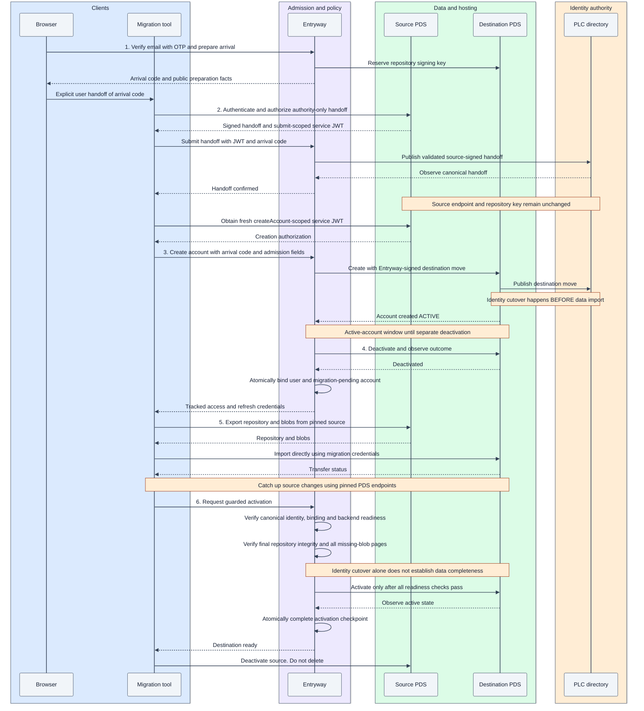

# How incoming account migration works

**Status:** accepted design, November 4, 2026; not yet implemented or qualified.

Incoming migration moves an existing account from an external PDS to a PDS behind
Entryway. The account keeps its DID and data. Its hosting endpoint, repository
signing key and destination login binding change. The behavior described below is
the accepted design identified above.

## Why Entryway migration differs from standalone PDS migration

With a standalone destination PDS, the usual sequence is to create a deactivated
account, transfer its repository and blobs, then update the DID's PLC record to
point to the destination. Data can arrive before the public identity changes.

A reference PDS configured behind Entryway has a different account-creation
contract. It accepts a PLC operation signed by its configured Entryway rotation
key, checks the destination endpoint and reserved repository key, and publishes
that operation as part of creating an active account. This contract ties account
creation to identity cutover rather than allowing cutover to wait until after import.

For an external DID, Entryway does not initially have the authority needed to sign
that operation. Migration therefore uses two PLC updates:

1. **Authority handoff:** the source signs an operation adding Entryway rotation
   authority while retaining the source endpoint, repository verification key and
   aliases. The account is still hosted at the source.
2. **Destination move:** Entryway signs the operation naming the selected PDS and
   its reserved repository key. The destination PDS publishes it during creation.

Entryway then deactivates the newly created destination account for data transfer.
This preserves the unchanged PDS contract, but means identity cutover happens
before import and there is an active-account window before deactivation. Publication
can also succeed even if the remainder of account creation fails.

Alongside this identity transition, Entryway establishes the destination login
binding and selects the hosting PDS. Destination email verification establishes
who can use that login; source authorization establishes who can move the DID.
Neither proof replaces the other.

The protocol accounts for four considerations:

- **Identity and custody:** the DID stays the same. Source authorization, destination
  email proof, invitation eligibility and arrival authorization are separate. The
  repository key, Entryway rotation key and recovery keys retain distinct roles.
- **Availability:** identity cutover precedes data import. The destination is briefly
  active before deactivation, so provisioning is not an atomic inactive operation.
- **Data integrity:** the client retains the original source endpoint after cutover,
  transfers a consistent repository snapshot and blobs, and catches up source changes.
  Destination activation depends on verified completeness, not identity cutover alone.
- **Recovery:** PLC publication, backend creation and local binding are separate
  writes. Durable operation state preserves ownership and progress when responses
  are lost or only part of the sequence succeeds.

The destination email is unique within Entryway and may differ from the source
email. This individual-arrival flow is distinct from whole-PDS adoption, which may
preserve existing shared-email associations, and from internal fleet moves.

## Migration lifecycle

The following stages describe observable account state, not database status values.

| Stage | Identity and hosting | Destination access |
| --- | --- | --- |
| 1. Arrival prepared | DID still points to the source; destination email, handle and repository key are reserved | Arrival authorization only; no account binding yet |
| 2. Authority handed off | Source hosting remains unchanged; Entryway has authorized rotation authority | Destination creation is eligible after canonical PLC observation |
| 3. Destination created | PLC points to the destination with its repository key | Backend account is initially active |
| 4. Destination paused and bound | Destination is deactivated; verified user and DID are bound locally | Migration credentials allow transfer while ordinary Entryway access is restricted |
| 5. Data transferred | Repository and blobs are copied and source changes caught up | Account remains migration-pending until readiness checks pass |
| 6. Destination activated | Identity, binding and data checks pass; destination is active | Normal destination access becomes available; the client deactivates the source |

### Sequence diagram

The numbered stages match the overview above. Recovery behavior is described below.



### Participants

| Component | Responsibility |
| --- | --- |
| Browser | Verify the destination email through OTP and hand arrival authorization to the tool |
| Migration tool | Obtain source authorization, coordinate public requests and transfer user data |
| Entryway | Admit arrivals, bind accounts, validate and publish PLC operations, provision the destination and guard activation |
| Source PDS | Authenticate the source account, authorize PLC signing and serve source data |
| Destination PDS | Store repository and blobs; keep its private repository signing key; apply supported lifecycle operations |

The migration tool follows an Entryway-specific journey through public APIs and
unchanged PDS contracts. Compatibility depends on support for this sequence, not
on a particular tool name or version.

## Admission proofs and credentials

| Proof or credential | Establishes | Does not establish |
| --- | --- | --- |
| Browser OTP/session | Destination login identity | Source DID or PLC authority |
| Operator invite code | Eligibility when invitations are configured | Email ownership or DID ownership |
| Arrival code | Access to one prepared destination arrival | Source DID authority by itself |
| Source service JWT | Incoming DID authorization for one Entryway method | Destination email ownership |
| Source PLC confirmation and signature | Authorization for the exact PLC handoff | Permission for every endpoint |
| Destination access/refresh credentials | Access to the admitted migration | Completion or ordinary active-account access |

### Invitation policy

`inviteCode` remains optional in the public `createAccount` schema.

When Entryway requires invitations, a missing code produces `InvalidInviteCode`
with a message requiring the code. When invitations are optional, omission is
allowed. A supplied code is validated in either configuration. Retrying the same
accepted creation does not consume another invitation.

### Arrival authorization

Preparation requires fresh destination OTP proof and CSRF protection. The resulting
arrival code is unpredictable and bound to the incoming DID, saved verified user
and destination reservation. Only its hash is stored; the code is excluded from
logs and URLs. The user hands it to the tool explicitly, without exporting browser
cookies.

A dedicated preparation interface and an `Entryway-Arrival-Code` header are the
proposed wire surface. They are Entryway-specific extensions, not existing AT
Protocol methods or implemented endpoints. Standard XRPC bodies remain unchanged.

## Protocol flow

### 1. Arrival preparation

The user verifies the destination email, supplies the incoming DID and requested
handle, and confirms the migration. Entryway checks email uniqueness and atomically
records the verified user ID, email/handle reservations, selected PDS, source PLC
head and key facts, approved custody configuration and operation ID.

Entryway journals the allocation obligation before reserving a repository signing
key on the selected PDS through its existing contract. The preparation response
contains arrival authorization, the Entryway service DID, explicit source and
destination endpoints, the expected PLC predecessor and public handoff configuration.

A supplied DID or reservation does not establish account ownership. Source proof
is required separately, and admission rate limits bound reservation abuse.

### 2. Source-authorized authority handoff

The tool authenticates to the source and obtains its public PLC confirmation and
signature through `requestPlcOperationSignature` and `signPlcOperation`.

The signed handoff retains source hosting, repository verification keys and aliases
while adding the required Entryway rotation authority. Entryway validates the exact
ordered key list against custody policy and protocol limits; a full list is not
silently truncated and recovery authority is not discarded. User recovery, operator
offline recovery, hot Entryway authority and the repository key remain distinct roles.

The tool obtains source service authentication with Entryway as audience and
`com.atproto.identity.submitPlcOperation` as the method, then sends:

```http
POST /xrpc/com.atproto.identity.submitPlcOperation
Authorization: Bearer <source service JWT>
Entryway-Arrival-Code: <arrival code>
Content-Type: application/json
```

The request body is the standard object with an `operation` property containing
the actual source-signed PLC operation object. It is not an encoded string.

Entryway independently verifies the source credential and destination arrival
ownership, then validates the operation signature, expected predecessor and exact
handoff facts. It persists the signed operation, CID, replay binding and publication
obligation before submitting directly to the configured PLC directory.

Destination creation becomes eligible only after Entryway observes the canonical
handoff. The destination PDS's submission handler is constrained to destination
identity facts, so this authority-only handoff goes to the directory instead.
Incoming authorization is separate from hosted-account authorization and does not
require an existing local account.

An exact already-applied operation is reconciled on retry. A changed request or
PLC head cannot silently replace the accepted operation. Signing or sending an
HTTP request is not evidence of publication.

### 3. Destination creation and identity cutover

The observed canonical handoff still retains the source repository key, allowing
fresh source authentication before final cutover.

The tool obtains a new service JWT scoped to `com.atproto.server.createAccount`
and calls Entryway with the standard DID/email/handle fields, operator invite code
when applicable, and arrival-code header. A submit-scoped JWT cannot authorize
creation.

Entryway matches the supplied facts to the saved arrival and applies invitation
policy before backend creation. It signs and journals the destination PLC operation
with the reserved repository key, target endpoint and approved destination custody.
The selected PDS receives that operation in its stock creation request, publishes
the identity move and creates the account active.

### 4. Deactivation, binding and migration access

Entryway separately deactivates the destination through the existing lifecycle
hook and observes the result. After confirmed provisioning and deactivation, it
atomically commits the local account, saved verified-user binding, email authority,
placement and migration-pending checkpoint. The standard creation response then
supplies tracked access/refresh credentials.

Successful creation means usable backend storage and credentials exist. Binding
precedes transfer because the client needs credentials to import data.
**Bound and migration-pending does not mean active:** ordinary access remains
restricted until completion. Ordinary signup activation semantics are unchanged.

### 5. Repository and blob transfer

The tool uses creation-response credentials rather than requiring a new destination
password. Entryway refreshes and recovers the tracked credentials. Access JWTs use
the backend audience and scopes understood by stock PDS, not an invented scope.

| Request | Send to |
| --- | --- |
| Source exports and blob downloads | Explicit original source PDS |
| Repository imports, blob uploads and transfer status | Explicit selected destination PDS |
| Admission, credential recovery and guarded activation | Entryway |

Both data endpoints remain pinned for the transfer. DID resolution now points at
the destination; retaining the original source endpoint keeps source exports
addressed to the correct PDS.

The client maintains a consistent source snapshot and catches up changes as
necessary. Application preferences may use their own public endpoints; they do
not prove repository completeness. The flow relies on public transfer endpoints,
not private fixture freezing or access to source signing credentials.

Backend deactivation and Entryway's pending-state guards restrict ordinary use.
Pending accounts are blocked from ordinary Entryway OAuth authorization, account
management and unguarded activation. Backend access JWTs still use stock PDS
permissions rather than a universal migration-only method restriction; the exact
permissions of reachable backend endpoints remain an interoperability consideration.

### 6. Readiness checks and activation

Before activation, Entryway independently verifies:

- Canonical PLC state, destination endpoint and expected keys.
- Destination placement, binding, backend readiness and unresolved operation state.
- Repository contents against the agreed final source snapshot.
- Every page of missing-blob results.

Counts, a client completion boolean, or zero missing blobs on an empty destination
are insufficient evidence. Valid empty and blob-free source repositories are
accepted when integrity checks agree. The exact public source/destination evidence
mechanism remains unresolved; synthetic snapshot assertions do not establish it.

All activation paths for pending arrivals share this readiness gate. Entryway
journals activation, invokes the lifecycle hook, observes the outcome and atomically
completes local activation with its checkpoint. Identity-only activation is
insufficient because cutover precedes data import.

The client deactivates the source after the destination is ready. Source deletion
is separate and is not scheduled automatically. Post-move login, OAuth, refresh
and direct PDS access remain part of independent interoperability qualification.

## Recovery and operation ownership

Each DID has at most one active migration operation, with completed history
preserved. Stable operation IDs, exact request facts, conditional transitions and
database-backed ownership apply on both database profiles. A stale worker cannot
complete a newer operation. Lease expiry does not prove that an earlier remote
write can no longer apply.

### Retries and credential replay

Repeated delivery of an accepted operation does not create another account,
consume another invitation or replace a signed operation. Credential reuse for
different facts is rejected. Replay acceptance is associated atomically with the
arrival and operation, leaving recoverable admission state when a credential is
consumed.

### Credential renewal

Arrival codes last **24 hours** and are renewable after fresh destination OTP.
Credential expiry does not destroy progress or end custody obligations.

Recovery uses the saved verified user binding, not an email match alone. It may
issue replacement migration credentials only for the same DID and destination.
After cutover, recovery no longer requires a source-key JWT because that key is no
longer the current repository verification key. Replacement credentials recover a
lost response without repeating account provisioning.

### Cancellation

Abandoned arrivals are not automatically deleted. Before handoff dispatch,
cancellation can release reservations only after checking for remote obligations
and changed PLC state. Once publication is possible, observed or uncertain, the
arrival and reservations remain available for reconciliation.

Deleting local state cannot remove published Entryway authority. Reversal requires
an authorized PLC operation; it is not an expiry side effect. The
[shared-operation recovery rules](shared-operations.md) govern mutation retries
and release of conflicting work.

### Partial completion and uncertain outcomes

- Source confirmation expires or is consumed before the signature response arrives.
- PLC publication succeeds but its response is lost, or the canonical head changes.
- Final cutover is published but backend account creation does not finish.
- Creation succeeds but destination deactivation fails or is uncertain.
- Binding/session issuance commits but the client loses the response.
- Imports are partial, source content changes, or blobs are unavailable.
- Activation applies but its acknowledgement is lost.

Recovery records retain public custody evidence and safe operation identifiers.
Reports exclude OTPs, arrival codes, bearer tokens and private keys.

## Related documentation

- [Data custody](data-custody.md): identity, key roles and atomic authority boundaries.
- [Shared operations](shared-operations.md): ownership and uncertain-write recovery.
- [Testing](testing.md): sandbox execution and evidence rules.
- [Migration and custody matrix](https://linear.app/hypercerts/document/migration-and-custody-matrix-b0c0d263da7c): maintained acceptance criteria and evidence.
- [Account specification](https://atproto.com/specs/account), [migration guide](https://atproto.com/guides/account-migration) and [XRPC specification](https://atproto.com/specs/xrpc): protocol references. The guide's usual ordering does not describe this backend's Entryway provisioning mode.
