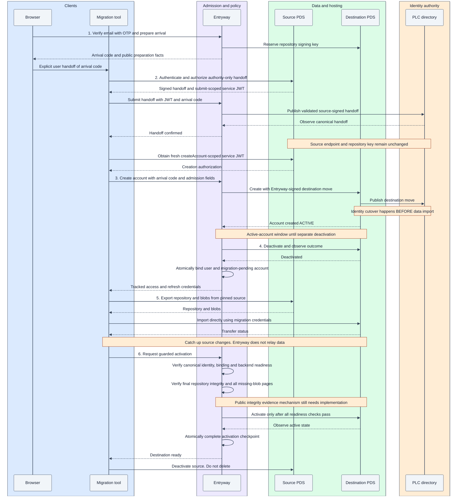

# Implement public incoming account migration

**Status:** accepted design, November 4, 2026; not yet implemented or qualified.

Use this guide when implementing Entryway admission, integrating a migration tool,
or reviewing the security and recovery behavior of an incoming migration. It
covers one user moving an existing DID from an external PDS to an unchanged PDS
already configured behind Entryway. It is not an operator runbook.

The DID and user data remain the same. The hosting PDS, repository signing key and
login binding change. The destination email must be unique within Entryway, but
may differ from the source email.

## Understand the required sequence

1. **Prepare:** verify the destination email in the browser and reserve an arrival.
2. **Authorize:** have the source sign an authority-only PLC handoff; Entryway
   publishes and observes it.
3. **Create:** Entryway signs the destination move and asks the selected PDS to
   create the account. The PDS publishes the move and creates the account active.
4. **Pause and bind:** Entryway separately deactivates the destination, establishes
   its login binding, and issues migration credentials.
5. **Transfer:** the client imports the repository and blobs directly into the PDS.
6. **Complete:** verify data and identity, activate the destination, and have the
   client deactivate the source.

**Identity cutover happens before data import.** The stock Entryway-configured PDS
cannot create this account atomically inactive while deferring PLC publication.
There is an active-account window before the separate deactivation. Publication
can also succeed before account creation finishes. Treat both as recoverable
failure boundaries, not as atomic provisioning.

### Accepted migration sequence

This diagram shows the intended successful path, not implemented behavior. The
numbered stages match the overview above; recovery rules follow later in this guide.



### Who owns each part?

| Component | Responsibility |
| --- | --- |
| Browser | Verify the destination email through OTP and hand arrival authorization to the tool |
| Migration tool | Obtain source authorization, coordinate public requests and transfer user data |
| Entryway | Admit arrivals, bind accounts, validate and publish PLC operations, provision the destination and guard activation |
| Source PDS | Authenticate the source account, authorize PLC signing and serve source data |
| Destination PDS | Store repository and blobs; keep its private repository signing key; apply supported lifecycle operations |

Entryway is not a managed transfer service and does not proxy ordinary application
writes. Whole-PDS adoption, internal fleet moves and outward-migration
qualification are separate operations. Whole-PDS adoption may preserve established
shared-email associations; individual arrivals may not create them.

Tools may implement an Entryway-specific public journey. PDS patches, private
fixture APIs, operator database edits and hidden recovery keys remain prohibited.
No particular tool is mandatory or presumed compatible.

## Keep admission proofs separate

| Proof or credential | Establishes | Does not establish |
| --- | --- | --- |
| Browser OTP/session | Destination login identity | Source DID or PLC authority |
| Operator invite code | Eligibility when invitations are configured | Email ownership or DID ownership |
| Arrival code | Access to one prepared destination arrival | Source DID authority by itself |
| Source service JWT | Incoming DID authorization for one Entryway method | Destination email ownership |
| Source PLC confirmation and signature | Authorization for the exact PLC handoff | Permission for every endpoint |
| Destination access/refresh credentials | Access to the admitted migration | Completion or ordinary active-account access |

### Apply invitation policy independently

`inviteCode` remains optional in the public `createAccount` schema.

- When Entryway requires invitations, reject a missing code with
  `InvalidInviteCode` and a message requiring the code.
- When invitations are optional, permit omission.
- Validate a supplied code in either configuration.
- Do not consume another invitation when retrying the same accepted creation.

### Issue arrival authorization through the browser

Require fresh destination OTP proof and CSRF protection during preparation. Issue
an unpredictable arrival code bound to the incoming DID, saved verified user and
destination reservation. Store only its hash. Exclude the code from logs and URLs.
The user hands it to the tool explicitly; tools do not export browser cookies.

A dedicated preparation interface and an `Entryway-Arrival-Code` header are the
proposed wire surface. They are Entryway-specific extensions, not existing AT
Protocol methods or implemented endpoints. Keep standard XRPC bodies intact and
document the extension for tool authors.

## Implement the migration stages

### 1. Prepare the arrival

**Input:** verified destination user, incoming DID and requested handle.

1. Confirm the intended migration and enforce unique destination-email admission.
2. Atomically record the saved verified user ID, email/handle reservations, selected
   PDS, source PLC head and key facts, approved custody configuration and operation ID.
3. Reserve a repository signing key on the selected PDS through its existing
   contract. Journal allocation and recovery state before dispatch.
4. Return arrival authorization and public preparation facts: Entryway service
   DID, explicit source/destination endpoints, expected PLC predecessor and the
   authority-only handoff configuration.

**Invariant:** entering a DID does not establish a binding. A conflicting
reservation cannot grant ownership or substitute for source proof. Bound
reservation abuse through admission rate limits.

### 2. Publish the source-authorized handoff

**Prerequisite:** the tool authenticates to the source and obtains its public PLC
confirmation and signature through `requestPlcOperationSignature` and
`signPlcOperation`.

The signed handoff must retain source hosting, repository verification keys and
aliases while adding the required Entryway rotation authority. Validate the exact
ordered key list against custody policy and protocol limits. Do not silently
truncate a full list or discard recovery authority. User recovery, operator offline
recovery, hot Entryway authority and the repository key remain distinct roles.

The tool obtains source service authentication with Entryway as audience and
`com.atproto.identity.submitPlcOperation` as the method, then sends:

```http
POST /xrpc/com.atproto.identity.submitPlcOperation
Authorization: Bearer <source service JWT>
Entryway-Arrival-Code: <arrival code>
Content-Type: application/json
```

The request body is the standard object with an `operation` property containing
the actual source-signed PLC operation object. It is not an encoded string.

Entryway must:

1. Independently verify the source credential and destination arrival ownership.
2. Validate the operation signature, expected predecessor and exact handoff facts.
3. Persist the signed operation, CID, replay binding and publication obligation.
4. Submit directly to the configured PLC directory.
5. Observe the canonical handoff before allowing destination creation.

Do not forward this handoff to the target PDS's destination-constrained submission
handler. Do not require an already-hosted account to authorize an incoming arrival;
keep existing hosted-account authorization separate.

**Retry rule:** reconcile an exact already-applied operation. A changed request or
PLC head cannot silently replace the accepted operation. Signing or sending an
HTTP request is not evidence of publication.

### 3. Create the destination and establish migration access

**Prerequisite:** the canonical handoff is observed. It still retains the source
repository key, allowing fresh source authentication before final cutover.

The tool obtains a new service JWT scoped to `com.atproto.server.createAccount`
and calls Entryway with the standard DID/email/handle fields, operator invite code
when applicable, and arrival-code header. A submit-scoped JWT cannot authorize
creation.

Entryway must:

1. Match all supplied facts to the saved arrival and enforce invitation policy.
2. Sign and journal the destination PLC operation with the reserved repository key,
   target endpoint and approved destination custody.
3. Invoke stock PDS creation with that operation. This publishes cutover and creates
   the account active.
4. Separately deactivate the destination through the existing lifecycle hook and
   observe the result.
5. Atomically commit the local account, saved verified-user binding, email authority,
   placement and migration-pending checkpoint.
6. Issue tracked access/refresh credentials in the standard creation response.

Do not report successful creation before usable backend storage and credentials
exist. Binding before transfer is intentional: the client needs credentials to
import. **Bound and migration-pending does not mean active.** Preserve ordinary
access restrictions until completion; existing signup activation semantics need
not change.

### 4. Transfer data directly between client and PDSs

The tool uses creation-response credentials rather than requiring a new destination
password. Entryway refreshes and recovers the tracked credentials. Access JWTs use
the backend audience and scopes understood by stock PDS, not an invented scope.

| Request | Send to |
| --- | --- |
| Source exports and blob downloads | Explicit original source PDS |
| Repository imports, blob uploads and transfer status | Explicit selected destination PDS |
| Admission, credential recovery and guarded activation | Entryway |

Pin both data endpoints. DID resolution now points at the destination and must
not redirect source exports there.

The client maintains a consistent source snapshot and catches up changes as
necessary. Application preferences may use their own public endpoints; they do
not prove repository completeness. Do not assume private fixture freezing or
source signing credentials are available.

Backend deactivation and Entryway's pending-state guards restrict ordinary use.
Entryway must block ordinary OAuth authorization, account management and unguarded
activation while pending. This is not a universal method-restricted backend token:
qualify every reachable stock endpoint's permissions.

### 5. Verify readiness and complete activation

Before activation, Entryway independently verifies:

- Canonical PLC state, destination endpoint and expected keys.
- Destination placement, binding, backend readiness and unresolved operation state.
- Repository contents against the agreed final source snapshot.
- Every page of missing-blob results.

Counts, a client completion boolean, or zero missing blobs on an empty destination
are insufficient evidence. Accept valid empty and blob-free source repositories
when integrity checks agree. The public source/destination evidence mechanism
still needs implementation and tests; synthetic snapshot assertions do not prove it.

Journal activation, invoke the lifecycle hook, observe the outcome, and atomically
complete local activation with its checkpoint. Every activation path for a pending
arrival must use this gate. Do not copy Rust's identity-only automatic activation:
our cutover precedes data import.

The client deactivates the source after the destination is ready. Source deletion
is separate and is not scheduled automatically. Independently qualify post-move
login, OAuth, refresh and direct PDS use.

## Recover without changing ownership

Retain one active operation per DID and preserve completed history. Use stable
operation IDs, exact request facts, conditional transitions and database-backed
ownership on both database profiles. Reject stale-worker completion. Lease expiry
does not prove that an earlier remote write can no longer apply.

### Distinguish retries from credential replay

Repeated delivery of an accepted operation must not create another account,
consume another invitation or replace a signed operation. Reject credential reuse
for different facts. Atomically associate replay acceptance with the arrival and
operation; do not spend a credential before recording recoverable admission.

### Renew access to the same arrival

Arrival codes last **24 hours** and are renewable after fresh destination OTP.
Credential expiry does not destroy progress or end custody obligations.

Recovery uses the saved verified user binding, not an email match alone. It may
issue replacement migration credentials only for the same DID and destination.
After cutover, do not require a source-key JWT: that key is no longer the current
repository verification key. Never replay provisioning just to recover a lost
credential response.

### Cancel only when no remote obligation remains

This scope introduces no automatic destructive abandonment cleanup. Before handoff
dispatch, cancellation may release reservations only after checking for remote
obligations and changed PLC state. Once publication is possible, observed or
uncertain, retain the arrival and reservations for reconciliation.

Deleting local state cannot remove published Entryway authority. Reversal requires
an authorized PLC operation; it is not an expiry side effect. Follow
[shared-operation recovery](shared-operations.md) before retrying mutations or
releasing conflicting work.

### Cover these failure boundaries

- Source confirmation expires or is consumed before the signature response arrives.
- PLC publication succeeds but its response is lost, or the canonical head changes.
- Final cutover is published but backend account creation does not finish.
- Creation succeeds but destination deactivation fails or is uncertain.
- Binding/session issuance commits but the client loses the response.
- Imports are partial, source content changes, or blobs are unavailable.
- Activation applies but its acknowledgement is lost.

Retain public custody evidence and safe operation identifiers. Never include OTPs,
arrival codes, bearer tokens or private keys in reports.

## Know what remains unimplemented

Existing reservation, ownership, binding, signing and session machinery provides
building blocks, not this public flow. Implement incoming authorization and
publication, unique individual-arrival email checks, earlier binding, guarded
activation and client routing. Keep synthetic migration as a separate fixture.

## Related documentation

- [Data custody](data-custody.md): identity, key roles and atomic authority boundaries.
- [Shared operations](shared-operations.md): ownership and uncertain-write recovery.
- [Testing](testing.md): sandbox execution and evidence rules.
- [Migration and custody matrix](https://linear.app/hypercerts/document/migration-and-custody-matrix-b0c0d263da7c): maintained acceptance criteria and evidence.
- [Account specification](https://atproto.com/specs/account), [migration guide](https://atproto.com/guides/account-migration) and [XRPC specification](https://atproto.com/specs/xrpc): protocol references. The guide's usual ordering does not describe this backend's Entryway provisioning mode.
